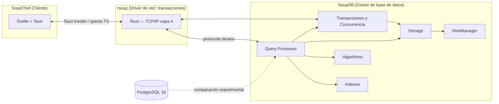
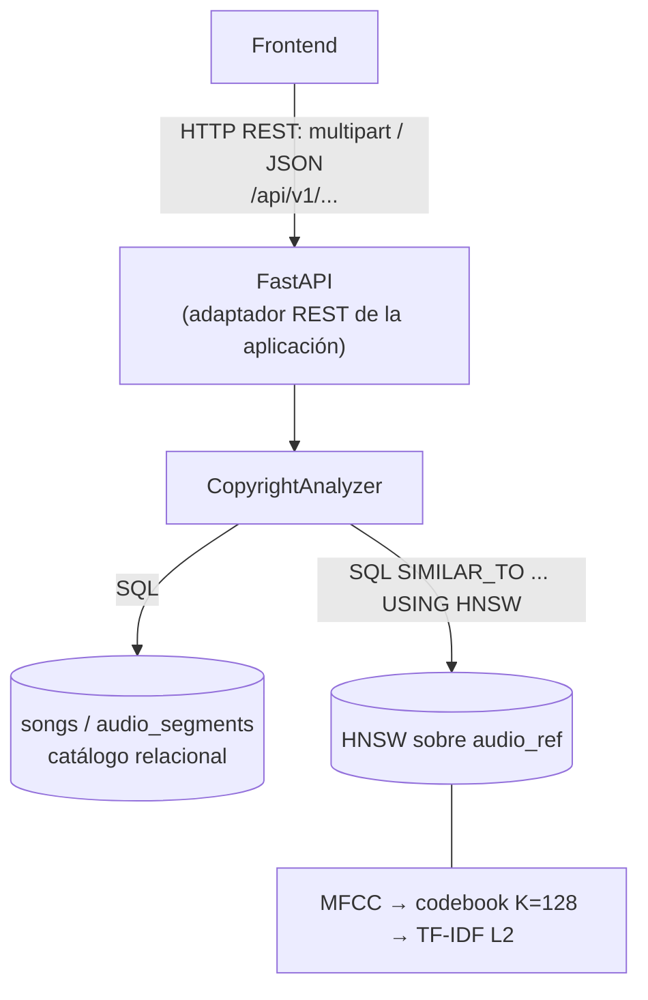

# SoupDB

[](https://github.com/BD2-Project/SoupDB/actions/workflows/ci.yml)
[](https://github.com/BD2-Project/SoupDB/actions/workflows/ci.yml)
[]()
[](LICENSE)
[]()

Motor de base de datos **multimodal** (relacional, espacial y vectorial) construido desde cero en Python, con integración de IA.

La aplicación final (Parte 5) es una **aplicación de análisis de similitud de audio** para
detectar posibles coincidencias entre un audio consultado y las canciones originales del
catálogo (copyright/remixes). Combina el catálogo relacional, el pipeline multimedia
MFCC/TF-IDF y el índice HNSW de SoupDB, y se expone al frontend por una API REST. Devuelve
**similitud acústica y evidencia temporal**, no un veredicto jurídico de infracción.

## IA aplicada

- **Búsqueda vectorial** (HNSW, IVF) para similitud entre descriptores.
- **Recuperación léxica** (índice invertido, BM25) con el plugin `soupdb-inverted`.
- **Extracción de características multimodales** (SIFT, MFCC, K-Means, bag of words TF-IDF).
- **Similitud de audio por segmentos** con evidencia temporal (aplicación de la Parte 5).

<p align="center"><sub>Proyecto académico · UTEC · Base de Datos 2 · ciclo 2026-2</sub></p>

## Arquitectura del gestor

**Arquitectura de plugins:** el núcleo (storage, tipos base, B+/hash/R-tree,
SQL y transacciones) se mantiene nativo. Full-text (`soupdb-inverted`) y
vectorial (`soupdb-vector`) son plugins instalables que declaran capacidades y
se descubren por entry points. El SQL uniforme de búsqueda es
`SEARCH(col, expr) USING <plugin> WITH (...)` + `SCORE()`. Ver
[plugins](docs/plugins.md) y [SQL de plugins](docs/sql_plugins.md).



Trabajo **multirepo**: `SoupDB` (gestor de base de datos), desarrollado en este repositorio; `rsoup` (driver de red y control de transacciones y concurrencia, en [BD2-Project/rsoup](https://github.com/BD2-Project/rsoup) — [documentación](https://github.com/BD2-Project/rsoup/tree/main/docs)); `SoupChef` (cliente de escritorio del gestor). El desarrollo se coordina mediante contexto compartido de arquitectura, reglas y convenciones que aplican a todos los equipos y a los agentes de IA.

El **driver `rsoup`** es el cliente Rust que los consumidores usan para conectarse al pool del gestor (TCP/IP, protocolo binario v1/v2, puerto `DRIVER_PORT`); el frontend SoupChef lo integra vía Tauri. Ver [docs/driver.md](docs/driver.md) y el protocolo en [docs/protocolo.md](docs/protocolo.md).

El protocolo binario TCP (puerto `55432`) es la **interfaz remota general del gestor**.
El núcleo `engine/` no expone REST ni GraphQL.

## Aplicación de la Parte 5: similitud de audio (copyright/remixes)

Código en [`applications/copyright_detection/`](applications/copyright_detection/);
guía completa (instalación, demo, API, decisiones y limitaciones) en
[docs/copyright_api.md](docs/copyright_api.md).

**Modalidades integradas:**

- **Relacional:** tablas `songs` y `audio_segments` en el motor SoupDB (B+ sobre los ids).
- **Multimedia/vectorial:** audio → MFCC → codebook K=128 → TF-IDF L2 → HNSW (euclidean)
  sobre `audio_segments.audio_ref`; cada hit del HNSW se resuelve por RID a su fila relacional.



La API FastAPI es el adaptador REST de la aplicación sobre las capacidades relacionales y
vectoriales de SoupDB. El frontend solo consume `/api/v1/...`; nunca toca el `Catalog`, el
HNSW, los archivos internos, el protocolo TCP ni SQL. El gestor sigue ofreciendo su propio
protocolo TCP (`rsoup`, puerto `55432`) para los clientes generales; son dos fronteras distintas.

Demo autocontenida (audio sintético generado en runtime, sin descargas):

```bash
uv sync --group copyright-api
uv run --group copyright-api python -m applications.copyright_detection.demo prepare --root .demo/copyright
# exporta las variables COPYRIGHT_* que imprime el comando anterior, y luego:
uv run --group copyright-api python -m applications.copyright_detection.runtime
curl -F "file=@.demo/copyright/sample_query.wav" http://127.0.0.1:8000/api/v1/analyze
```

## Dependencias

| Dependencia | Uso | Instalación |
|---|---|---|
| Python ≥ 3.11 | Motor de base de datos | python.org o gestor del SO |
| uv | Gestor de paquetes y entornos | `curl -LsSf https://astral.sh/uv/install.sh \| sh` |
| Docker | Contenedor y despliegue local | Docker Desktop o gestor del SO |
| PostgreSQL 16 | Comparación experimental | `docker compose up postgres` o gestor del SO |
| typst | Informe técnico (`paper/`) | gestor del SO |

## Setup

```bash
# Instalar dependencias y crear el entorno
uv sync --all-groups

# Solo lo necesario para el servidor de la Parte 5 (FastAPI + soupdb-vector)
uv sync --group copyright-api

# Tests y lint
uv run pytest
uv run ruff check .

# Documentación (build local)
uv run --group docs mkdocs build

# Informe técnico
typst compile paper/main.typ paper/soupdb.pdf

# Levantar el gestor sin docker (escucha en 55432)
uv run python -m engine

# Despliegue local (gestor + postgres con PostGIS)
docker compose up
```

El gestor queda escuchando el protocolo binario en el puerto `55432`, que es al
que se conectan el driver `rsoup` y el cliente `SoupChef`.

Si el puerto ya está ocupado en tu máquina:

```bash
DRIVER_PORT=55435 POSTGRES_PORT=55434 docker compose up
```

Configuración por variables de entorno: `SOUPDB_DATA` (directorio de datos),
`DRIVER_HOST`, `DRIVER_PORT`, `PAGE_SIZE`, `BUFFER_POOL_SIZE`,
`MAX_CONNECTIONS` y `LOCK_TIMEOUT_MS`.

## Gestión de paquete y contenedor

- **Paquete:** el motor se gestiona con **uv** (`pyproject.toml` + `uv.lock` versionado). El wheel se construye con `uv build` y se adjunta a cada release. El runtime no tiene dependencias externas (solo stdlib).
- **Contenedor:** `Dockerfile` multi-stage (build con uv sobre imagen slim) + `docker-compose.yml` con los servicios `engine`, `postgres:16` y `web` (placeholder `SoupChef`). La imagen del engine se publica en **GHCR** (`ghcr.io/BD2-Project/soupdb`) al crear un tag de versión.

## Documentación

- API reference y guías: https://BD2-Project.github.io/SoupDB
- Informe técnico (typst): se publica como **PDF** en las [Releases](https://github.com/BD2-Project/SoupDB/releases).
- Estrategia de versionado de releases: `docs/estrategia-release.md`.

## Licencia

MIT — ver [LICENSE](LICENSE).