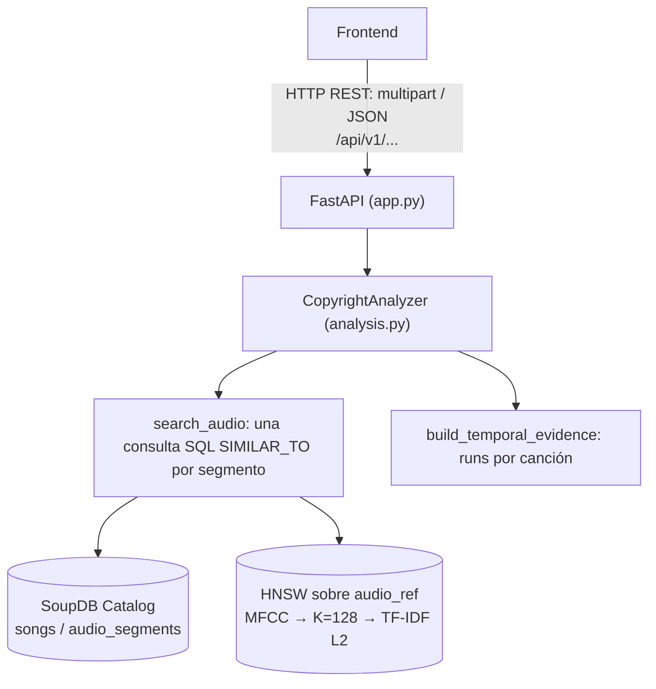

# Aplicación de similitud de audio (Parte 5)

## Propósito

La aplicación de la Parte 5 (opción C) analiza la **similitud entre un audio consultado
y las canciones originales del catálogo** para detectar posibles coincidencias
(copyright/remixes). Para cada tramo del audio subido indica qué canciones y qué tramos
de ellas se parecen, con qué similitud y con qué coherencia temporal.

!!! warning "Evidencia, no veredicto"
    La aplicación devuelve **similitud acústica y evidencia temporal**. No determina
    copyright, no prueba una infracción, no da probabilidades y no aplica ningún umbral.
    Qué evidencia es significativa se decidirá aparte y deberá calibrarse
    experimentalmente.

Integra dos capacidades de SoupDB:

- **Relacional:** tablas `songs` y `audio_segments` en el motor SoupDB.
- **Multimedia/vectorial:** audio → MFCC → codebook K=128 → TF-IDF L2 → HNSW (euclidean)
  sobre `audio_segments.audio_ref`.

## Arquitectura



La API FastAPI es el adaptador REST de la aplicación sobre las capacidades relacionales y
vectoriales de SoupDB.

- El **núcleo SoupDB** (`engine/`) no tiene REST ni GraphQL. Su interfaz remota nativa es
  el protocolo binario sobre TCP/IP en el puerto `55432` (`python -m engine`), que usa el
  driver `rsoup`; ver [Driver](driver.md) y [Protocolo](protocolo.md). La aplicación no
  lo modifica.
- La **aplicación de la Parte 5** (`applications/copyright_detection/`) usa SoupDB dentro
  del mismo proceso (`Catalog` + SQL + HNSW) y publica una API REST. Esa API es la única
  frontera del frontend: solo consume `/api/v1/...` y nunca toca el `Catalog`, el HNSW,
  los archivos internos, el protocolo TCP ni SQL.

La aplicación no forma parte del wheel `soupdb`, que solo empaqueta `engine`, y el núcleo
sigue sin dependencias externas.

| Módulo | Papel |
|---|---|
| `settings.py` | Variables `COPYRIGHT_*` → `RuntimeSettings` (solo parsing, stdlib) |
| `runtime.py` | Servidor ejecutable: `lifespan` que abre y cierra el `Catalog` |
| `app.py` | `create_app`: rutas, errores HTTP y CORS (import ligero) |
| `analysis.py` | `CopyrightAnalyzer`: staging → búsqueda → evidencia → JSON |
| `catalog.py`, `ingestion.py` | Catálogo relacional e ingesta de originales |
| `indexing.py` | Codebook K=128 y HNSW por SQL |
| `search.py`, `evidence.py` | Búsqueda por segmentos y evidencia temporal |
| `demo.py` | Preparación de una demo sintética |

## Instalación

```bash
uv sync --group copyright-api
```

El grupo `copyright-api` instala todo lo que necesita el servidor real: FastAPI,
python-multipart, uvicorn y `soupdb-vector`, que a su vez trae librosa, numpy,
scikit-learn, soundfile y el resto. No depende del grupo `dev`:
`uv sync --no-dev --group copyright-api` instala solo el runtime. El grupo `dev` incluye
`copyright-api`, así que `uv sync` basta para correr los tests.

## Preparar la demo

La demo es autocontenida. Genera en runtime tres canciones sintéticas deterministas
(Alpha 20 s, Beta 15 s y Gamma 12.5 s), sin material con copyright y sin WAV
versionados, y prepara la base con las APIs reales:

```
WAV originales → CopyrightCatalog.initialize() → ingest_song()
→ train_codebook(K=128) → open_catalog() → ensure_index(HNSW euclidean) → close()
```

```bash
uv run --group copyright-api python -m applications.copyright_detection.demo prepare --root .demo/copyright
```

Estructura (`.demo/` está en `.gitignore`):

```
.demo/copyright/
  dataset/tracks/{alpha,beta,gamma}.wav   originales
  dataset/queries/                        staging de uploads (vacío)
  db/                                     base SoupDB (songs: 3, audio_segments: 10)
  artifacts/codebook.npz                  codebook K=128 + IDF
  artifacts/cache/                        caché de MFCC
  artifacts/vectors/                      HNSW persistente
  artifacts/training_manifest.jsonl       manifest de entrenamiento
  sample_query.wav                        audio de prueba (idéntico a Alpha)
  demo.json                               marca de demo completa
```

`sample_query.wav` es solo un input de usuario: está fuera del dataset y no se registra
en SoupDB. El comando imprime las rutas y las variables `COPYRIGHT_*` listas para copiar.

Si `--root` ya contiene una demo completa, se reutiliza sin modificarla. Si existe con
otro contenido o con una preparación interrumpida, el comando falla y pide borrarlo a
mano: la herramienta nunca borra directorios.

## Ejecutar el servidor

El runtime asume una base ya preparada: **no entrena el codebook ni crea o reconstruye
el índice**.

- **Al arrancar** (`lifespan` de FastAPI) abre el `Catalog` con `open_catalog`, comprueba
  con `require_index` que el HNSW existe y está cargado, crea el `CopyrightAnalyzer` y lo
  instala en la app.
- **Al apagar** cierra el `Catalog` una sola vez.
- **Si falta** una variable, un directorio o el índice, el servidor no arranca y cierra lo
  que hubiera abierto.

Bash:

```bash
export COPYRIGHT_DB_PATH=.demo/copyright/db
export COPYRIGHT_DATASET_ROOT=.demo/copyright/dataset
export COPYRIGHT_CODEBOOK_PATH=.demo/copyright/artifacts/codebook.npz
export COPYRIGHT_DESCRIPTOR_CACHE=.demo/copyright/artifacts/cache
export COPYRIGHT_VECTOR_STORAGE=.demo/copyright/artifacts/vectors
uv run --group copyright-api python -m applications.copyright_detection.runtime
```

PowerShell:

```powershell
$env:COPYRIGHT_DB_PATH=".demo/copyright/db"
$env:COPYRIGHT_DATASET_ROOT=".demo/copyright/dataset"
$env:COPYRIGHT_CODEBOOK_PATH=".demo/copyright/artifacts/codebook.npz"
$env:COPYRIGHT_DESCRIPTOR_CACHE=".demo/copyright/artifacts/cache"
$env:COPYRIGHT_VECTOR_STORAGE=".demo/copyright/artifacts/vectors"
uv run --group copyright-api python -m applications.copyright_detection.runtime
```

También se puede arrancar con uvicorn. En ese caso el host y el puerto salen de las
opciones de uvicorn, no de `COPYRIGHT_HOST`/`COPYRIGHT_PORT`:

```bash
uv run --group copyright-api uvicorn applications.copyright_detection.runtime:app --port 8000
```

Prueba:

```bash
curl -F "file=@.demo/copyright/sample_query.wav" http://127.0.0.1:8000/api/v1/analyze
```

Responde HTTP 200. La primera run es la de Alpha (0–20 s del audio ↔ 0–20 s de la
canción), con `segment_count=4`, `is_best_run=true` y score ≈ 1.0; ver el ejemplo de la
sección API.

**Variables de entorno.** Las rutas relativas se resuelven contra el directorio de
trabajo del proceso. Una variable opcional vacía o ausente toma su valor por defecto. Un
valor inválido detiene el arranque; nunca se sustituye en silencio por el valor por
defecto.

| Variable | Por defecto | Validación |
|---|---|---|
| `COPYRIGHT_DB_PATH` | obligatoria | directorio existente con la base |
| `COPYRIGHT_DATASET_ROOT` | obligatoria | directorio del dataset (escribible: ahí va el staging) |
| `COPYRIGHT_CODEBOOK_PATH` | obligatoria | `.npz` existente que produzca vectores de dimensión 128 |
| `COPYRIGHT_DESCRIPTOR_CACHE` | obligatoria | carpeta de la caché de MFCC |
| `COPYRIGHT_VECTOR_STORAGE` | obligatoria | directorio existente con el HNSW |
| `COPYRIGHT_SEARCH_K` | `5` | entero decimal entre 1 y 1000 |
| `COPYRIGHT_STAGING_DIR` | `queries` | ruta relativa canónica con `/` |
| `COPYRIGHT_HOST` | `127.0.0.1` | interfaz de escucha (solo con `python -m ...runtime`) |
| `COPYRIGHT_PORT` | `8000` | entero entre 1 y 65535 (solo con `python -m ...runtime`) |
| `COPYRIGHT_CORS_ORIGINS` | vacío | orígenes `http(s)://host[:puerto]` separados por comas |

**CORS.** Con la variable vacía no se habilita CORS. Para un frontend de desarrollo en
otro origen:

```bash
export COPYRIGHT_CORS_ORIGINS="http://localhost:5173,http://127.0.0.1:5173"
```

Se permiten los métodos `GET` y `POST` y las cabeceras `Accept` y `Content-Type`, que es
lo que necesita `POST multipart /api/v1/analyze`. El valor `*` se rechaza: los orígenes
se enumeran uno a uno.

`applications.copyright_detection.app:app` sigue existiendo como app sin analizador: al
importarse no lee el entorno ni abre nada, y responde 503 en `/analyze`. El servidor
ejecutable es `runtime`.

## API

La documentación interactiva está en `/docs` y el esquema en `/openapi.json`.

| Método | Ruta | Respuesta |
|---|---|---|
| `GET` | `/api/v1/health` | `200 {"status": "ok", "service": "soupdb-copyright-api"}` |
| `POST` | `/api/v1/analyze` | `200 AnalysisResult` con la evidencia temporal |

### `POST /api/v1/analyze`

Recibe un archivo de audio como `multipart/form-data` en el campo `file`:

```bash
curl -F "file=@remix.wav" http://127.0.0.1:8000/api/v1/analyze
```

Flujo:

```
POST multipart
→ staging único  <dataset_root>/queries/<analysis_id>/candidate.wav
→ segmentación 5 s (iter_audio_segments)
→ una consulta HNSW euclidean por segmento (k vecinos)
→ evidencia temporal (runs por canción)
→ JSON AnalysisResult
→ borrado del archivo y de su carpeta
```

La lógica vive en `applications/copyright_detection/analysis.py`
(`CopyrightAnalyzer`); FastAPI solo recibe el multipart, llama al servicio y
traduce errores. `search_k` (vecinos por segmento, `COPYRIGHT_SEARCH_K`, por
defecto 5) no es un umbral.

Respuesta real del servidor de la demo (`sample_query.wav`, idéntico a Alpha,
`search_k=5`), recortada a la primera run de dos canciones:

```json
{
  "analysis_id": "aeb1eb30c00940d196be845ac2adf00f",
  "filename": "sample_query.wav",
  "segment_seconds": 5.0,
  "matches": [
    {
      "query_start": 0.0, "query_end": 20.0,
      "song_id": 1, "title": "Alpha", "artist": "Demo Ensemble",
      "source_start": 0.0, "source_end": 20.0,
      "score": 0.999999976788879,
      "segment_count": 4,
      "min_score": 0.9999999735362719, "max_score": 0.9999999802395061,
      "alignment_offset_seconds": 0.0,
      "is_best_run": true
    },
    {
      "query_start": 0.0, "query_end": 10.0,
      "song_id": 3, "title": "Gamma", "artist": "Demo Ensemble",
      "source_start": 0.0, "source_end": 10.0,
      "score": 0.41421356292998734,
      "segment_count": 2,
      "min_score": 0.41421356229651984, "max_score": 0.4142135635634548,
      "alignment_offset_seconds": 0.0,
      "is_best_run": true
    }
  ]
}
```

(La respuesta completa trae 13 runs: las de Alpha con otros offsets y las de Gamma y
Beta, todas con score ≈ 0.414. Ese valor es `1 / (1 + √2)`, la distancia entre vectores
TF-IDF L2 sin palabras acústicas en común. Aparecen porque no hay umbral.)

Cada elemento de `matches` es una **run de evidencia temporal** (ver "Evidencia
temporal"):

| Campo | Significado |
|---|---|
| `query_start`, `query_end` | Tramo del audio subido (s); el último segmento puede durar menos de 5 s |
| `song_id`, `title`, `artist` | Canción del catálogo |
| `source_start`, `source_end` | Tramo alineado de la canción (s) |
| `score` | **Media de los scores de similitud** de los segmentos de la run (euclidean: `1 / (1 + distancia)`, en `[0, 1]`) |
| `segment_count` | Segmentos consecutivos de 5 s que forman la run |
| `min_score`, `max_score` | Menor y mayor score de similitud de la run |
| `alignment_offset_seconds` | `source_start - query_start` |
| `is_best_run` | `true` en exactamente una run por canción: la de más evidencia temporal |

Se devuelven **todas** las runs, sin filtrar por score ni por número de
segmentos: canciones de más a menos coherentes y, dentro de cada una, en orden
temporal del audio subido. Si no hay evidencia, `matches` es `[]` (HTTP 200).

`analysis_id` es un `uuid4` y es el mismo de la carpeta de staging; `filename`
es solo el nombre presentado por el cliente, sin componentes de ruta
(`../../x.wav` → `x.wav`), y nunca decide dónde se escribe el archivo.

!!! warning "Evidencia, no veredicto"
    La API devuelve evidencia de similitud acústica y temporal. **No determina
    copyright**, no prueba una infracción ni da una probabilidad. No hay umbral:
    cuál evidencia es significativa se decidirá aparte y deberá calibrarse
    experimentalmente. El frontend puede mostrar `score * 100` siempre como
    "similitud", no como probabilidad.

**Errores:**

| Código | Cuándo |
|---|---|
| `422` | Falta `file` (detalle de validación de FastAPI), o el audio está vacío, no se puede decodificar o no produce ningún segmento (≥ 2.5 s) |
| `503` | Análisis no configurado (app sin analizador, como `app.py:app`) o índice/perfil no disponible |
| `500` | Error interno inesperado; respuesta genérica sin traceback (el detalle queda en el log) |

**Staging y limpieza.** Cada análisis escribe el upload por bloques en una
carpeta nueva `queries/<analysis_id>/`, porque la caché de MFCC del perfil usa la
ruta absoluta como clave: reutilizar una ruta devolvería descriptores de un audio
anterior. El archivo y su carpeta se borran siempre al terminar, también si el
audio es inválido o la búsqueda falla. La carpeta raíz `queries/`, la caché, el
codebook y el índice no se tocan. La caché conserva entradas de esas rutas
temporales ya borradas (nunca se reutilizan); limpiarlas es una mejora futura.
El candidato nunca se inserta en `songs`, `audio_segments` ni en el HNSW.

**Concurrencia.** El `Catalog` compartido no está documentado como thread-safe:
el servicio serializa la búsqueda y la evidencia con un `RLock`. Las escrituras de
staging de análisis simultáneos van en paralelo y nunca colisionan.

## Catálogo relacional

`applications/copyright_detection/catalog.py` (`CopyrightCatalog`) guarda el
catálogo en el **motor relacional real de SoupDB**: un `engine.common.catalog.Catalog`
abierto sobre una ruta explícita, que persiste en disco y se recarga al reabrir.
No usa otra base de datos.

```python
from pathlib import Path

from engine.common.catalog import Catalog
from applications.copyright_detection.catalog import CopyrightCatalog, Song

catalog = Catalog(Path("data/copyright"))
db = CopyrightCatalog(catalog)
db.initialize()  # crea las tablas que falten; nunca borra datos
db.add_song(Song(1, "Canción", "Artista", "tracks/song001.mp3", 183.5))
catalog.close()
```

| Tabla | Columnas |
|---|---|
| `songs` | `song_id INT`, `title TEXT`, `artist TEXT`, `audio_path TEXT`, `duration_seconds FLOAT` |
| `audio_segments` | `segment_id INT`, `song_id INT`, `segment_index INT`, `start_seconds FLOAT`, `end_seconds FLOAT`, `audio_ref TEXT` |

Hay índices B+ sobre `songs.song_id`, `audio_segments.segment_id` y
`audio_segments.song_id`. Los ids los asigna quien llama (SoupDB no tiene
autoincremento).

`audio_ref` identifica un segmento con la misma convención que la Parte 4
(`soupdb_vector.multimedia.audio_features.segment_id`):
`<audio_path>#segment=NNNNNN`, por ejemplo `tracks/song001.mp3#segment=000001`.
`audio_path` es relativo a la raíz del dataset. Esa columna es la que usará el
pipeline multimedia; el índice HNSW se crea aparte (ver "Índice HNSW del catálogo").

SoupDB no tiene `UNIQUE`, `FOREIGN KEY`, `IF NOT EXISTS` ni `UPDATE` ejecutable,
y su `PRIMARY KEY` no impide duplicados. Por eso `CopyrightCatalog` comprueba
antes de cada inserción que los ids no estén repetidos, que el segmento apunte a
una canción existente, que una canción no repita `segment_index` y que
`audio_ref` sea la referencia canónica del segmento. Si una tabla ya existe con
otro schema, `initialize()` falla con `IncompatibleSchemaError`.

Limitación actual: esas comprobaciones se serializan con un lock de la propia
instancia, que solo protege un proceso. No sustituye restricciones del motor, no
coordina varios procesos y registrar una canción con sus segmentos no es atómico;
se resolverá al integrar la ingesta con transacciones.

## Pipeline multimedia: ingesta y segmentación

`applications/copyright_detection/ingestion.py` registra una canción original del
dataset en el catálogo. Requiere `soupdb-vector` (librosa), incluido en los grupos
`copyright-api` y `dev`; `app.py` no importa este módulo.

```python
from applications.copyright_detection.ingestion import SongMetadata, ingest_song

result = ingest_song(
    db,  # CopyrightCatalog ya inicializado
    Path("datasets/originales"),  # raíz del dataset
    SongMetadata(1, "Canción", "Artista", "tracks/song001.wav"),
    first_segment_id=1,
)
```

- **Raíz del dataset:** `audio_path` es relativo a ella, con `/` y en forma
  canónica. Se rechazan rutas absolutas, `#`, `..` u otras rutas que salgan de la
  raíz, archivos inexistentes y directorios.
- **Segmentación:** la misma de la Parte 4, `iter_audio_segments` de
  `soupdb_vector.multimedia.audio_features`: bloques consecutivos de 5 s sin
  solapamiento, audio en mono a 22 050 Hz. El último bloque solo se conserva si
  dura al menos `MIN_SEGMENT_RATIO` (la mitad, 2.5 s): una pista de 13 s da
  0–5, 5–10 y 10–13; una de 12 s da 0–5 y 5–10, y la cola de 2 s no tiene fila.
  Si no sale ningún segmento, la ingesta falla y no registra la canción.
- **Intervalos:** `start_seconds = segment_index × 5.0` y
  `end_seconds = start_seconds + muestras_del_segmento / 22050`.
- **Duración:** `songs.duration_seconds` es la duración real decodificada
  (`len(load_audio(path)) / 22050`), incluida la cola descartada; no la suma de
  segmentos. El archivo se decodifica dos veces (duración y segmentos) porque la
  API pública del plugin no da ambos a la vez.
- **Ids:** el caller da `song_id` y `first_segment_id`; cada segmento recibe
  `first_segment_id + segment_index`. Antes de escribir se comprueba que ningún id
  esté ocupado, que la canción y su `audio_path` no estén ya registrados y que el
  audio se decodifique. Si algo falla no se escribe nada: `AudioIngestionError`
  (o `ValueError` si los metadatos o `first_segment_id` no son válidos).
- **Atomicidad:** la escritura posterior (canción y luego cada segmento) no es
  transaccional; un fallo a mitad puede dejar la canción con parte de sus segmentos.

Esta capa **no extrae MFCC, no genera vectores ni construye HNSW**.

## Índice HNSW del catálogo

`applications/copyright_detection/indexing.py` indexa `audio_segments.audio_ref`
con el **HNSW real de SoupDB**, usando la integración SQL de `soupdb-vector`
(`MultimediaProfile` + `OnDiskVectorFactory` + `Catalog(..., ranked_factory=...)`):

```
audio_ref → MFCC (por segmento de 5 s) → codebook K=128 → TF-IDF L2 → HNSW (euclidean)
```

Orden de construcción, con rutas que da el caller (`CopyrightIndexConfig`:
raíz del dataset, `codebook.npz`, caché de descriptores y carpeta del índice):

1. Ingestar **todo** el catálogo (sección anterior).
2. `train_codebook(...)`: genera desde el catálogo un manifest `audio_segment`
   (rutas relativas, ordenado por `segment_id`; solo artefacto de construcción) y
   entrena con `build_vectors.train_from_manifest` un codebook de **K=128**
   palabras acústicas, que se guarda una vez y nunca se sobrescribe.
3. `open_catalog(db_path, config)`: abre la base con el perfil
   `copyright-audio-v1` (`kind="audio_segment"`) y valida que el codebook dé
   vectores de dimensión 128.
4. `ensure_index(catalog, config)`: si no existe, ejecuta

   ```sql
   CREATE INDEX copyright_audio_hnsw ON audio_segments (audio_ref) USING HNSW
   WITH METRIC=euclidean, DIMENSION=128, PROFILE='copyright-audio-v1'
   ```

   Si ya existe con esa configuración lo reutiliza sin reconstruirlo; si existe
   con otra, falla.

No se genera `vectores.bin`: la factoría vectoriza cada fila al crear el índice.
El HNSW guarda el **RID** de cada fila; una consulta resuelve cada hit a su fila
real de `audio_segments`, de donde salen `segment_id` y `song_id`:

```sql
SELECT segment_id, song_id, audio_ref, SCORE() AS score FROM audio_segments
WHERE SIMILAR_TO('tracks/a.wav#segment=000001', k=3) USING HNSW WITH METRIC=euclidean
ORDER BY score DESC
```

Con métrica euclidean, `SCORE()` es `1 / (1 + distancia)`: mayor es más parecido
y el propio segmento da 1.0. Es una similitud, no una probabilidad de copyright.

**Persistencia:** el HNSW y su metadata (`sql_index.json`, con la huella del
codebook, la raíz del dataset y el perfil) quedan en disco. Al reabrir con
`open_catalog` y la misma configuración se recargan sin reconstruir; si el
codebook, la raíz o el perfil cambiaron, la apertura falla.

**Limitaciones:**

- Con el índice creado, el motor bloquea `INSERT`/`DELETE` en `audio_segments`
  fuera de una `TransactionalSession`, así que la ingesta rechaza canciones
  nuevas. Para ampliar el catálogo habrá que integrar la ingesta con
  transacciones o reconstruir el índice.
- La base indexada debe abrirse siempre con `open_catalog`.

El índice no aplica umbral ni decide copyright; el análisis completo de un
archivo se expone en `POST /api/v1/analyze`.

## Búsqueda por segmentos de un candidato

`applications/copyright_detection/search.py` busca un audio candidato contra el
catálogo indexado:

```python
from applications.copyright_detection.indexing import open_catalog
from applications.copyright_detection.search import search_audio

catalog = open_catalog(db_path, config)  # índice ya creado (sección anterior)
result = search_audio(catalog, config, "queries/remix.wav", k=5)
```

- **Ubicación del candidato:** `audio_path` es relativo a la raíz
  del perfil (`config.dataset_root`), porque el vectorizador del perfil solo
  resuelve rutas ahí. Se valida igual que los originales (relativo, `/`, sin `#`,
  dentro de la raíz, archivo existente). El candidato **no** se inserta en
  `songs`, `audio_segments` ni en el HNSW. Cada candidato distinto debe tener su
  propia ruta: la caché de descriptores usa la ruta como clave.
- **Segmentación:** la misma que los originales (`iter_audio_segments`): bloques
  de 5 s y el último solo si dura al menos 2.5 s. Un candidato de 13 s da 0–5,
  5–10 y 10–13; uno de 12 s da 0–5 y 5–10. Si no hay ningún segmento, falla
  antes de consultar.
- **Una consulta HNSW por segmento**, por SQL y el planner real:

  ```sql
  SELECT segment_id, song_id, segment_index, start_seconds, end_seconds, audio_ref,
         SCORE() AS score FROM audio_segments
  WHERE SIMILAR_TO('queries/remix.wav#segment=000000', k=5) USING HNSW WITH METRIC=euclidean
  ORDER BY score DESC
  ```

  El vectorizador aplica al segmento el mismo MFCC → codebook → TF-IDF L2 del
  índice, y cada hit se resuelve por RID a su fila real de `audio_segments`.
- **Resultado:** `AudioSearchResult(audio_path, k, segments)`. Cada
  `QuerySegmentResult` tiene `query_segment_index`, `query_start_seconds`,
  `query_end_seconds` y sus `matches` propios (no se mezclan entre segmentos).
  Cada `SegmentMatch` tiene `segment_id`, `song_id`, `title`, `artist`,
  `source_segment_index`, `source_start_seconds`, `source_end_seconds`,
  `audio_ref` y `score`.
- **`k`:** entero positivo; son los vecinos por segmento, no un número de
  detecciones. Si el catálogo tiene menos segmentos, se devuelven los que haya.
- **`score`:** `1 / (1 + distancia euclidiana)`; mayor es más parecido y un
  segmento idéntico da ≈ 1.0. **No es una probabilidad de copyright.**

Esta capa no aplica umbral ni agrega por canción (eso lo hace la evidencia
temporal) y no decide copyright.

## Evidencia temporal

`applications/copyright_detection/evidence.py` convierte el resultado de la
búsqueda por segmentos en evidencia temporal por canción. Es una transformación
pura: no lee audio, no ejecuta SQL y no vuelve a buscar.

```python
from applications.copyright_detection.evidence import build_temporal_evidence

evidence = build_temporal_evidence(search_audio(catalog, config, "queries/remix.wav", k=5))
```

- **Alineamiento:** para cada match,
  `alignment_offset_segments = source_segment_index - query_segment_index`.
- **Agrupación:** por canción (`song_id`) y, dentro de ella, por offset.
- **Runs:** dentro de cada grupo, ordenado por `query_segment_index`, una run
  continúa solo si el siguiente segmento de consulta es el inmediato (`+1`), y
  con él el de origen; un hueco o un cambio de offset empiezan otra run.
- **Intervalos:** candidato desde el inicio del primer punto hasta el fin del
  último; igual en el original. Los segmentos finales cortos conservan su fin
  real (por ejemplo 10–13 s, no 10–15).
- **Métricas por run:** `segment_count`, `mean_score` (media aritmética),
  `min_score` y `max_score`, sin redondear.
- **`best_run` de cada canción:** mayor `segment_count`; luego mayor
  `mean_score`; mayor `min_score`; menor `query_start_seconds`; menor
  `source_start_seconds`. La continuidad pesa más que un pico de score aislado.
- **Orden de canciones:** por su `best_run` (`segment_count`, `mean_score`,
  `min_score` descendentes) y luego `song_id`. Significa "evidencia temporal más
  coherente primero", **no** "más probable que infrinja".
- Las runs de una canción van en orden temporal del candidato.

Ejemplo: matches `q0→A#10 (0.94)`, `q1→A#11 (0.92)`, `q2→A#12 (0.95)` forman una
run de la canción A con offset 10: candidato 0–15 s ↔ original 50–65 s,
`segment_count=3`, `mean_score≈0.9367`, `min_score=0.92`, `max_score=0.95`.

**Sin umbral, a propósito.** Se usan todos los matches recibidos, también los de
score bajo; una run con scores bajos sigue siendo una run estructural. La
decisión de qué evidencia es significativa (y cualquier umbral, que habrá que
calibrar experimentalmente) pertenece a una capa posterior. `score` sigue siendo
la similitud del motor, no una probabilidad de copyright.

## Decisiones técnicas

| Decisión | Valor |
|---|---|
| Segmentación | 5 s, sin solapamiento; el último bloque se conserva solo si dura ≥ 2.5 s |
| Sample rate | 22 050 Hz, mono |
| MFCC | 20 coeficientes |
| Codebook | K=128 (K-Means) |
| Representación | TF-IDF con normalización L2 |
| Índice | HNSW |
| Métrica | euclidean |
| Búsqueda | k vecinos por segmento, configurable con `COPYRIGHT_SEARCH_K` (por defecto 5) |
| Score | `1 / (1 + d)`: similitud, no probabilidad |

HNSW se eligió por el benchmark de audio de la Parte 4 sobre 100 000 segmentos:
Recall@10 ≈ 0.990 y ≈ 12.3 ms por consulta. Son cifras de ese benchmark, no de la demo,
y no significan que HNSW supere siempre a IVF: fue la mejor opción en esas condiciones.

## Limitaciones

- No hay un umbral calibrado: se devuelven todas las runs.
- `score` es una similitud, no una probabilidad, y la respuesta no es un veredicto
  jurídico.
- Como los segmentos no se solapan, la resolución temporal es de 5 s.
- Las búsquedas de un mismo proceso se ejecutan de una en una, protegidas por un `RLock`,
  porque el `Catalog` no está documentado como thread-safe.
- La caché de MFCC conserva las entradas de los uploads ya borrados; no se limpian.
- Con la API actual no se pueden añadir canciones una vez creado el HNSW: haría falta
  integrar la ingesta con transacciones o reconstruir el índice.
- No hay límite de tamaño para los uploads.
- El frontend se desarrolla por separado y solo consume la API REST.
